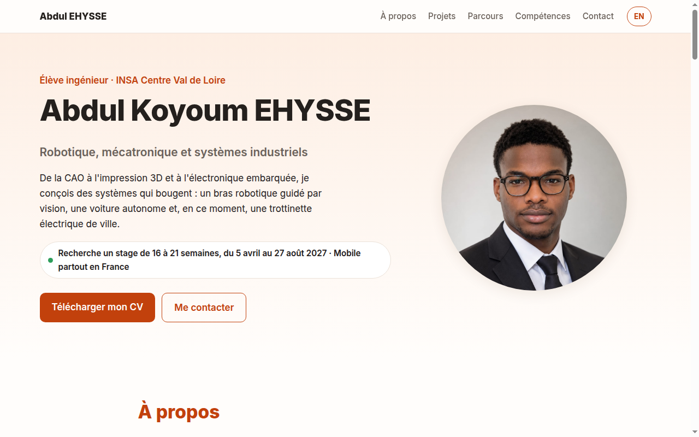

# Portfolio – Abdul Koyoum EHYSSE

Élève ingénieur en Génie des Systèmes Industriels à l'INSA Centre Val de Loire : robotique, mécatronique et méthodes industrielles.

**Site en ligne : https://abdulkoyoum.github.io/Portfolio_Cv_AK/**

Site statique en HTML, CSS et JavaScript, sans framework ni étape de build, bilingue français / anglais, publié avec GitHub Pages.

## Structure

| Fichier | Rôle |
|---|---|
| `index.html` | Tout le contenu, en français |
| `styles.css` | Mise en page, couleurs (variables dans `:root`), mode sombre, version mobile |
| `main.js` | 1. Traductions anglaises · 2. Carrousels photos et vidéos · 3. Apparition au défilement |
| `assets/cv/` | CV en PDF, français et anglais |
| `assets/img/` | Photo de profil, icône, médias des projets (`projets/`) |

## Modifier le site

- **Un texte** : le changer dans `index.html`, puis sa traduction (même clé `data-i18n`) dans l'objet `EN` de `main.js`.
- **Une photo ou une vidéo de projet** : déposer le fichier dans `assets/img/projets/` (nom en minuscules, sans espace ni accent), puis l'ajouter à la liste du projet dans l'objet `MEDIA` de `main.js`. Vidéos en `.mp4`, moins de 20 Mo.
- **Le CV** : remplacer les PDF dans `assets/cv/` en gardant les mêmes noms.

Chaque modification passe par une branche et une pull request ; le merge dans `main` met le site à jour en une à deux minutes.

## Voir le site en local

Ouvrir `index.html` dans le navigateur, ou lancer `python -m http.server` dans ce dossier puis aller sur http://localhost:8000.
